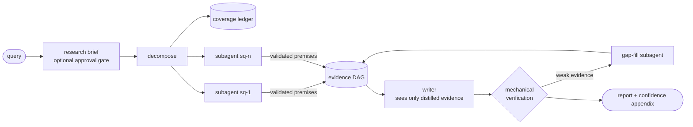

<p align="center">
  <picture>
    <source media="(prefers-color-scheme: dark)" srcset="assets/logo-dark.svg">
    
  </picture>
</p>

<p align="center"><strong>The research agent harness that shows its work.</strong><br>
Claims triangulated across independent sources · confidence computed, never asserted · every run replayable byte-for-byte</p>

<p align="center">
  
  
  <a href="https://github.com/finianoneill/parsec/actions/workflows/ci.yml"></a>
  
  
</p>

---

## Why parsec

Parallax is how astronomers find true distance: observe a star from two ends of Earth's orbit and measure the shift against the background. A **parsec** is the distance at which that shift is one arcsecond — truth derived from independent vantage points, geometrically, not by trusting any single observation.

Parsec applies the same principle to LLM research agents. Most agents produce fluent reports you have to take on faith. Parsec produces reports you can **audit mechanically**:

- **No claim without a path.** Every sentence in the final report traces through a typed evidence graph — claim → finding → premise → verbatim source span — or it is rejected before you ever see it.
- **No confidence without computation.** Sources carry priors, independent corroboration raises credence via noisy-OR, shaky chains visibly decay, and the report's hedging ("X is true" vs. "one source suggests") is a function of the computed number — never vibes.
- **No run that can't be replayed.** Every fetch is content-addressed, every model call and state transition is event-logged. Any session re-executes byte-identically against its frozen corpus, which makes every harness change measurable.

The model never executes anything: it emits structured intents; the harness validates, executes, and records (see the design tenets below).

## How it works



1. **Scope, then decompose.** The orchestrator produces a persisted *research brief* — scope, an effort estimate the harness enforces as dispatch caps (quick / standard / deep), and the subquestions — each tracked in a coverage ledger (`open / answered / partial / blocked / dropped` — blocked requires an explicit reason, and the writer refuses to run while anything is still open). With `--brief-gate`, the brief waits for your approval or edits, recorded as steering events so the gated session still replays.
2. **Research in isolation.** Each subquestion gets a subagent with retrieval tools only — subagents are the *only* consumers of raw documents, and they cannot spawn subagents (the recursion ban is structural, not a prompt). Facts enter the system through one door: a `record_premises` tool that rejects any premise whose numbers or quotes don't match the cited span exactly.
3. **Write behind a firewall.** The writer sees the query, the recorded premises/findings with computed confidence tiers, and the coverage gaps — never a raw document, never the research transcript. Every factual sentence must cite premise/finding IDs.
4. **Verify mechanically.** Structural checks (every claim reaches an intact span), exact number/quote containment — for each premise against its spans, and for each report sentence against the premises and findings it cites — temporal-ordering checks against evidence dates, grounded-NLI support advisories (does the span actually *say* that?), credence propagation, and bottom-up omission detection — what did the report *fail* to say? — all run without a remote model. A sentence whose figure or quotation is not in what it cites goes back to the writer once; if it still fails, the answer ships as `partial` with that sentence marked `[unverified]`. A premise states only what its span states; a figure derived from sources is a `computes` finding whose arithmetic the harness re-runs, and one it cannot re-run is recorded as an unverified derivation — always flagged, never treated as evidence. What is mechanically checked is numbers and quotations: a wrong direction ("rose" for "fell") or a swapped entity is caught only by the advisory NLI tier. A claim below the stakes threshold becomes a search gradient: the harness localizes the weakest premise and dispatches one targeted gap-fill subagent. Coverage gets the same treatment: a subquestion still *partial* while budget headroom remains is retried with its shortfall named (`--max-coverage-gap-rounds`), and a primary-tier source that yielded no readable text (an unminable PDF, a blocked fetch) demotes its subquestion to partial — the loss is named in the ledger and the report, never silently papered over with secondary sources.
5. **Report honestly.** The answer ships with a harness-built appendix: per-claim confidence tiers, sources consulted but unused, premises recorded but uncited.

## Design tenets

The load-bearing decisions; when an implementation choice conflicts with a tenet, the tenet wins. Code comments cite these by number (T1–T12).

- **T1 — The harness owns all side effects.** The model never executes anything: it emits structured tool-call intents; the harness validates, executes, truncates, and injects results. The model is a stateless planner/synthesizer.
- **T2 — Research has no oracle, so verification must be structural.** There is no "tests pass" for a report; the machine-checkable substitute is the evidence DAG — every claim traces through typed derivation edges to source spans. Verification is graph traversal first, LLM judgment last.
- **T3 — Premises carry credence, never presumption.** No source is assumed true: every root node gets a computed prior (source tier × independent corroboration × recency-vs-volatility), and confidence propagates rather than being asserted.
- **T4 — Everything is replayable.** Content-addressed fetches, event-logged model/tool calls and state transitions; any run re-executes byte-identically against its frozen corpus. Without this, no change to the system is measurable.
- **T5 — Context is a budgeted resource with an explicit ledger.** Per-turn token accounting, cache-aware prompt assembly (stable prefix, append-only suffix), and a compaction ladder that degrades gracefully.
- **T6 — Subagents are context firewalls.** The orchestrator never sees a raw document; subagents burn their windows on sources and return typed findings. Recursion is banned structurally, not by prompt.
- **T7 — Rippable over clever.** Model capabilities improve fast; prefer thin, deletable mechanisms. The durable assets are the data model, the corpus, and the eval suite — not the loop logic.
- **T8 — Concurrency is recorded, not forbidden.** Parallel subagents are fine because every nondeterministic boundary — and its arrival order — is journaled; replay feeds recorded results through a deterministic scheduler.
- **T9 — Verification is tiered by trust, and the mechanical tier is never enough.** Structure < grounded-NLI support < advisory judge; every new verifier is benchmarked before it gates anything, and NLI never sole-gates — exact-match stays the floor.
- **T10 — Credence must survive correlated, conflicting, and stale evidence.** Corroboration counts independent content clusters (not domains); conflict lowers confidence rather than averaging away; facts carry mutability classes and can be superseded; the numbers get recalibrated or stay internal.
- **T11 — The archive is ours; provider responses are borrowed.** The content-addressed archive of self-fetched documents is permanent (the replay substrate); provider API responses are TTL-bounded per provider policy. Fetching is identity-honest: descriptive UA, robots respected, 402/RSL surfaced as typed outcomes, never circumvented.
- **T12 — Every improvement lands with its measurement.** No workstream merges without the eval that detects its regression; paired-difference stats with confidence intervals replace raw threshold gates.

> Historical note: code comments also cite section and workstream labels (`§n`, `WS-x`) from the original architecture brief and v2 plan, which have been retired from the tree — both are preserved in git history (`git log --all --oneline -- RESEARCH_HARNESS_ARCHITECTURE.md RESEARCH_HARNESS_V2_PLAN.md`).

## Install

Requires Python 3.12+ and [uv](https://docs.astral.sh/uv/).

```sh
git clone https://github.com/finianoneill/parsec.git
cd parsec
uv sync
uv run pytest        # full suite — no network, no API keys needed
```

To get a `parsec` command on your PATH (so it runs from any directory, not just via `uv run` inside the repo):

```sh
uv tool install --editable .   # installs ~/.local/bin/parsec; --editable tracks your checkout
```

Live runs need `ANTHROPIC_API_KEY`. The optional synthesis judge needs `OPENAI_API_KEY` (a *different model family* grades the prose — parsec never lets a model grade its own homework).

## Quick start

No API keys? Start with the interactive shell and the built-in demo:

```sh
# Launch the interactive shell (welcome screen + REPL). With no
# ANTHROPIC_API_KEY it points you at the offline tour:
parsec

# Or run the demo directly: a complete recorded run — scripted model,
# bundled fixture corpus, no keys, no network. The recording is a real
# session you can replay, verify, and inspect afterwards:
parsec demo
```

(Prefix commands with `uv run` instead if you skipped the global tool install.)

### The interactive shell

Running `parsec` with no subcommand prints the welcome banner — the parallax mark, the gradient wordmark, and a status line showing your data directory and whether an API key was found — then drops into a REPL:

```
parsec ❯ /demo               # offline tour: full recorded run, no keys, no network
parsec ❯ /sessions           # list recorded sessions
parsec ❯ /show <id>          # one session's spend and coverage
parsec ❯ /replay <id>        # re-run against the frozen corpus, verify byte-identical
parsec ❯ /verify <id>        # mechanical verification + credence report
parsec ❯ /diff <a> <b>       # what changed between two runs of one question
parsec ❯ /refresh <id>       # re-run a session's question now, diff against it
parsec ❯ /notebook <id>      # the session's append-only notebook
parsec ❯ how tall is Olympus Mons        # bare text runs a live query (needs a key)
parsec ❯ /edit               # compose a long/multi-line query in $EDITOR
parsec ❯ /exit               # leave (ctrl-d works too)
```

The shell keeps arrow-key history across sessions (`~/.parsec_history`), and `/edit` opens `$EDITOR` to compose long or multi-line queries.

Sessions record into `./data` relative to where you launch; pass `--data-dir` (or set `data_dir` in a config file, below) to keep one home for all recordings.

### Configuration files

Every flag you'd otherwise repeat can live in JSON config, layered as `~/.parsec.json` (user) < `./.parsec.json` (project) < explicit flags. Keys mirror the CLI option names; string values expand `${ENV_VARS}`:

```json
{
  "data_dir": "~/.parsec/data",
  "search_provider": "searxng",
  "searxng_url": "http://localhost:8080",
  "contact": "you@example.com",
  "max_usd": 2.0
}
```

Unknown keys are rejected loudly (typo protection). The interactive banner shows which config files were loaded.

### Claude via Amazon Bedrock

If your org reaches Claude through Bedrock instead of an Anthropic API key, install the signing dependencies and point the adapter at your AWS profile:

```sh
uv sync --extra bedrock              # or: uv tool install --editable ".[bedrock]"
okta-awscli --profile okta           # or aws sso login, etc. — anything that writes
                                     # credentials into the standard AWS chain
```

Then set it once in config (or pass `--adapter bedrock --aws-region … --aws-profile …` per run):

```json
{
  "adapter": "bedrock",
  "aws_region": "us-east-1",
  "aws_profile": "okta"
}
```

Auth is the standard AWS credential chain — env vars, then `~/.aws/credentials` — which is exactly where okta-awscli drops its temporary STS credentials, so re-running `okta-awscli` when they expire is the whole refresh story. Model IDs are prefixed automatically (`claude-opus-5` → `anthropic.claude-opus-5`); no `ANTHROPIC_API_KEY` is needed. Recording, replay, and budgets behave identically to the first-party adapter.

### Editing the research brief in $EDITOR

With `ask --brief-gate`, the run pauses at the proposed research brief. Besides typing `approve` or feedback on stdin, type `edit` to open the proposed brief (scope, effort, subquestions) in `$EDITOR` — the text you save is submitted as the brief-edit steering message, so the gated session still replays byte-identically.

With a key, live runs work from the shell or the CLI:

```sh
export ANTHROPIC_API_KEY=...

# Ask a question with a live search provider (SearXNG shown; brave/serper
# need BRAVE_API_KEY / SERPER_API_KEY). fetch is robots-respecting and
# write-through cached; provider responses are cached TTL-bounded:
parsec ask "your question" --search-provider searxng --searxng-url http://localhost:8080 --live

# Or run fully offline with a fixture provider:
parsec ask "your question" --search-fixtures fixtures/queries.json

# Re-run it against the frozen corpus and verify byte-identical replay:
parsec replay <session-id>

# Re-verify the evidence graph later (catches corpus tampering after the fact):
parsec verify <session-id>
```

A search fixture file maps queries to result URLs:

```json
{
  "your question keywords": [
    {"title": "Page title", "url": "https://example.com/page", "snippet": "..."}
  ]
}
```

While a run is live, type on stdin to **steer** it — your message is injected into the next model call without tearing down the turn, and steered sessions still replay byte-identically.

### Gates

Two decision points can pause a live run for your input, both built on the same replay-safe primitive (a journaled proposal blocks for one steering reply, recorded gate-tagged and turn-indexed, so gated sessions replay byte-identically):

- `--brief-gate` pauses at the proposed research brief — `approve` dispatches, `edit` opens it in `$EDITOR`, anything else requests changes.
- `--cost-gate 0.5` pauses **once** when spend crosses that fraction of the USD cap at a dispatch boundary — `approve` continues; any other reply stops dispatching, remaining subquestions resolve as declined, and the writer wraps up with what was gathered.

## Commands

| Command | What it does |
|---|---|
| `parsec` | Interactive shell: welcome screen + REPL over the commands below (bare text runs `ask`) |
| `parsec demo` | Built-in offline demo — a full recorded run with no API keys and no network |
| `parsec ask "…"` | Run a research query. In a terminal, a live activity view narrates the run — thinking, searches, fetches with typed outcomes, subagent dispatch/joins, retries with their backoff, phase changes, spend — straight from the event stream (`--live` forces it, `--json` disables). Ctrl-C halts gracefully at the next gate (journaled `USER_ABORT`, session finished as `halted_user`; Ctrl-C again force-quits). (`--parallel N` for concurrent subagents (≤5), `--brief-gate` to approve/edit the research brief before dispatch, `--cost-gate 0.5` to pause once for approval when spend crosses that fraction of the USD cap, `--max-usd`/`--max-tokens`/`--max-turns`/`--max-gap-rounds`/`--max-coverage-gap-rounds` for budgets, `--retry-attempts` for the harness's journaled model-call retries, `--request-timeout` to bound a wedged model call (default 180s; a trip is a journaled retry, and an in-flight call is also cut at the wall-clock budget), `--cache-mode record\|replay\|live-prefer-cache`, `--cache-strategy full\|system` for prompt-cache breakpoint placement, `--keep-awake` to hold off macOS idle sleep for the run — a sleeping laptop drops every in-flight call and pauses the wall clock) |
| `parsec replay <session>` | Re-execute against the frozen corpus; verifies projections and answer bytes are identical |
| `parsec verify <session>` | Mechanical verification (structural, sentence support, temporal ordering, grounded-NLI advisories) + credence + omission report over the stored evidence graph. A session is checked under the behaviour it was recorded with; `--rescore-with current` applies today's checks instead. Read-only either way |
| `parsec diff <a> <b>` | Claim-level diff of two sessions of the same question: held / strengthened / weakened / superseded / retracted / new, each change with the premise-level evidence delta behind it, plus source deltas (same URL, changed content). Exits 3 on material change |
| `parsec refresh <session>` | Re-run a recorded session's query as a new session seeded by its brief and coverage ledger: stable-evidence subquestions carry forward (identical node IDs, no dispatch), volatile/slow or unresolved ones re-research live, then the claim-level diff against the original is emitted. `--all` re-researches everything. Exits 3 on material change |
| `parsec fork <session> --at-call N` | Rewind to model-call N and branch live (`--steer "…"` to redirect the branch) |
| `parsec judge <session>` | Advisory judge pass (different model family) over `deduces`/`induces` derivations |
| `parsec eval make-case <session>` | Snapshot a recorded session into a frozen eval case |
| `parsec eval export-case <case_dir>` | Write a case's corpus as text (`corpus/`: JSONL tables + blobs) so it can be committed; `data/` is binary and gitignored |
| `parsec eval import-case <case_dir>` | Rebuild a case's `data/` from its text corpus (a case with only `corpus/` also runs as-is) |
| `parsec eval run <cases> --out r.json` | Score cases on every registered metric (citation faithfulness, coverage, nugget recall, claim support, advisory synthesis judge; `--metrics` picks a subset) and diagnose each case's losses |
| `parsec eval compare a.json b.json` | Paired-difference diff of two results files plus the loss-taxonomy delta; exits 3 when a *mechanical* axis regresses beyond epsilon |
| `parsec eval analyze r.json` | Why each case lost points: loss patterns by category (retrieval / extraction / writing / verification / coverage / harness / case), per case |
| `parsec watch <session>` | Scheduled refresh: re-check a question on an interval (`--every 6h`, `--rounds N`; one round without `--every` — cron-friendly), refreshing the newest session in the chain each round, reporting only material diffs, and labeling the prior run's claims held/overturned as `(credence, outcome)` pairs appended to `watch-labels.json` for `parsec calibrate`. Exits 3 when any round was material |
| `parsec calibrate labels.json` | Fit Platt scaling over labeled credences (eval results files work directly); reports Brier, smooth ECE, risk-coverage, and the tier ranges `ask --calibration` renders |
| `parsec sessions list` / `show <session>` | Sessions, spend (totals and per stream — which subquestion spent what), and the coverage ledger |
| `parsec notebook <session>` | The session's append-only notebook (plan, statuses, evidence IDs, dead ends) |
| `parsec spans show <span-id>` | Spot-check any citation against the verbatim stored span |

## The evidence graph

Five node tiers, six typed edges — the edge type selects the verification strategy:

| Tier | Node | Produced by |
|---|---|---|
| 0 | `SourceSpan` | fetch: verbatim text at `doc:<hash>#<start>-<end>` |
| 1 | `Premise` | `record_premises`, after mechanical number/quote containment checks |
| 2 | `Finding` | subagent reports: derived via `deduces` / `induces` / `temporal` edges, or `computes` — a typed operation (unit conversion, sum, difference, ratio, percent change, rounding) the harness recomputes with exact decimal arithmetic |
| 3 | `Synthesis` | cross-subagent merges (reserved) |
| 4 | `ReportClaim` | one per factual sentence in the final answer |

Conflicting evidence gets `contradicts` edges — and they participate in propagation: opposing support becomes disbelief, so two strong disagreeing sources land near "genuinely uncertain" instead of both reading as near-certain (on a mutable claim, newer evidence *supersedes* older instead). Credence propagates as `min(parents) × edge_penalty` along a derivation. Corroboration is counted once, inside the premise, as noisy-OR over independent *content* clusters — twelve syndicated copies of one wire story count once, whatever domains they sit on. A report claim is then exactly as credible as the weakest distinct fact it cites: citing more premises never raises it, and a finding cited beside its own parent premise is one line of evidence, not two. Recency is measured per observation, not per download. For facts classed as slow- or fast-changing (stable facts never decay), each supporting span is dated (a date the premise gives and the span states, else the document's publication date, else unknown) and decayed by its distance from the time the subquestion asks about — a 2019 figure is strong evidence for "what was it in 2019?" and weak evidence for "what is it now?". "Now" is the session's recorded reference time, never a clock. (Sessions recorded before observation dates existed keep the scoring they were recorded with, which aged evidence by fetch time.) Users see tiers plus uncertainty provenance — high / moderate / low, single source, conflicting sources, possibly stale, date unknown, superseded, unverified derivation — never raw numbers pretending to be calibrated probabilities. Once `parsec calibrate` has fitted your measured outcomes, tiers render with quantified ranges ("high (72–96%)").

## Determinism & budgets

**Byte-identical replay** means: the canonical projection of the event stream (timestamps stripped; token and dollar debits kept) and the final answer blob are byte-equal between a run and its replay. Everything that could break this is engineered around it: content-derived IDs, canonical JSON everywhere, deterministic compaction, steering re-injection, clock-free credence. Concurrency doesn't break it either (`ask --parallel N`, N≤5): each subagent is its own event stream, the observed completion order is journaled as join events, and replay folds results in the *recorded* order through a deterministic scheduler — the Temporal pattern, so the projection compares per-stream plus join order.

Budget caps default deliberately low and are debited in real time to a per-actor, per-stream ledger: `$0.50` / `200k tokens` / `300s` / `12 turns`. Raise them explicitly (`--cost-gate` adds a mid-run approval checkpoint instead of a hard stop). Research stops dispatching at 80% of the wall budget (`writer_wall_reserve`), so the writer and one repair round always start with time on the clock — the turn budget had reserved one turn for the writer since M1; wall time reserved nothing until M15.8. Fan-out research is a token-spend strategy — parsec makes the spend visible per node of the graph it bought, and per subquestion after the fact.

**Failures are part of the trajectory.** Model-call errors classify into an actionable taxonomy (throttled / overloaded / context-overflow / transient / fatal); retryable ones back off with bounded, jitter-free delays journaled per attempt as `LLM_RETRY` events, context overflows trigger compaction-and-retry instead of a dead subagent, and all of it replays: the replay adapter serves recorded failed attempts before a call's final outcome, so a throttled-and-recovered run reproduces its exact retry sequence. Sessions also record the parsec version that produced them — `replay` and `fork` warn on mismatch, so a divergence reads as version skew rather than corruption.

**Prompt caching** defaults to full-prefix placement on new runs (`--cache-strategy full`): breakpoints on the system block, the tool-schema array, and a rolling marker on the final message block, so each request's append-only prefix re-bills at 0.1× on the next call. Placement is recorded per session; pre-existing recordings keep their original wire shape and still replay.

## Evals

Every eval case is a frozen world: corpus, fixtures, query, gold (`must_find` list, weighted `nuggets` with contradiction patterns, verified `gold_docs`, planted `distractor_docs`). Runs fork the corpus by file copy and execute in replay cache mode, so two git revisions score against literally identical inputs:

```sh
uv run parsec eval run evals/cases --out results-main.json --label main
git checkout my-change && uv run parsec eval run evals/cases --out results-change.json
uv run parsec eval compare results-main.json results-change.json   # exit 3 on regression
uv run parsec eval analyze results-change.json                     # why: the loss taxonomy
```

**Metrics are a seam, not a list** (M15.1). An axis is any object with a `name`, a `tier`, and `score(ctx)` over the recorded session plus the case's gold; built-ins register by name in `parsec.evals.metrics`, and every results file carries a manifest of which metrics scored it. The tier is T9 made structural: `mechanical` axes (no model, deterministic over the frozen world) are the only ones `eval compare` may call *regressed*; the `advisory` synthesis judge — a different model family, still never a gate — reports its verdict and nothing more.

**Losses are named, not inferred** (M15.2). A score says a nugget went missing; the loss taxonomy says *where*: the gold page never surfaced in search, surfaced and went unfetched, fetched and would not extract, extracted with no premise recorded, premise recorded and never cited, or cited in words the gold pattern does not match. Each is a different fix in a different module, and every one is already journaled — so the diagnosis is a pure function of the recording and the gold, no model involved. Per-document retrieval stages, cited distractors, structural violations per claim, unresolved citations, coverage rows with their recorded reasons, and harness incidents (budget halts, subagent deaths, journaled retries, tool errors, compactions, premise rejections) ride in the results file per case; `eval compare` diffs the pattern histogram so a change reads as "retrieval losses 4 → 0, extraction losses 0 → 3" and not only as a number moving. A miss that cannot be localized says so (declare `gold_docs`), and a miss whose gold docs were all read but contain no match points at the case's patterns, not the agent.

## Project layout

```
src/parsec/
├── cli.py, interactive.py,      # entry points: subcommands, REPL shell,
│   banner.py, demo.py           #   welcome banner, keyless offline demo
├── db/, store/      # the durable core: schema, event log, blobs, spans, DAG,
│                    #   coverage ledger, notebook, budget ledger
├── gateway/         # the single door to any model: Anthropic generator,
│                    #   OpenAI judge, fake/replay/fork adapters, cost capture
├── retrieval/       # search-provider seam, cache-routed fetcher, span indexer
├── tools/           # registry + validation: search_broad, fetch, record_premises
├── verify/          # mechanical verification: structure, containment,
│                    #   credence, omission, judge pass
├── evals/           # frozen cases, the metric seam, loss taxonomy,
│                    #   trajectory metrics, paired-difference compare
└── loop/            # the deliberately thin, rippable part: state machine,
                     #   prompts, citations, compaction, orchestrator
```

The loop is replaceable by design; the durable assets are the data model, the corpus, and the eval suite.

## Changelog

Release notes, and the full milestone log (M0–M15), are in [CHANGELOG.md](CHANGELOG.md).

## Development

```sh
uv run pytest                                        # full suite in random order, no network/keys
uv run ruff check src tests                          # lint (version pinned in uv.lock)
uv run mypy                                          # type-check src
uv run pytest -m live tests/integration/test_live_smoke.py   # one real query + replay (needs ANTHROPIC_API_KEY)
```

Changes should keep the whole suite green and — for anything touching the loop, tools, or stores — preserve byte-identical replay; the integration tests will catch you if they don't.

## License

[Apache-2.0](LICENSE).
